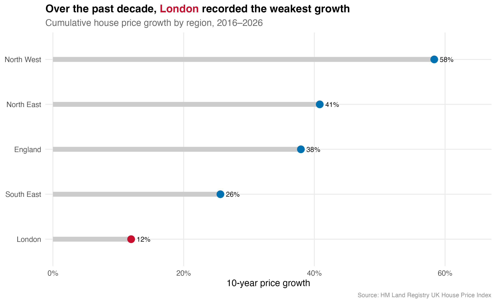
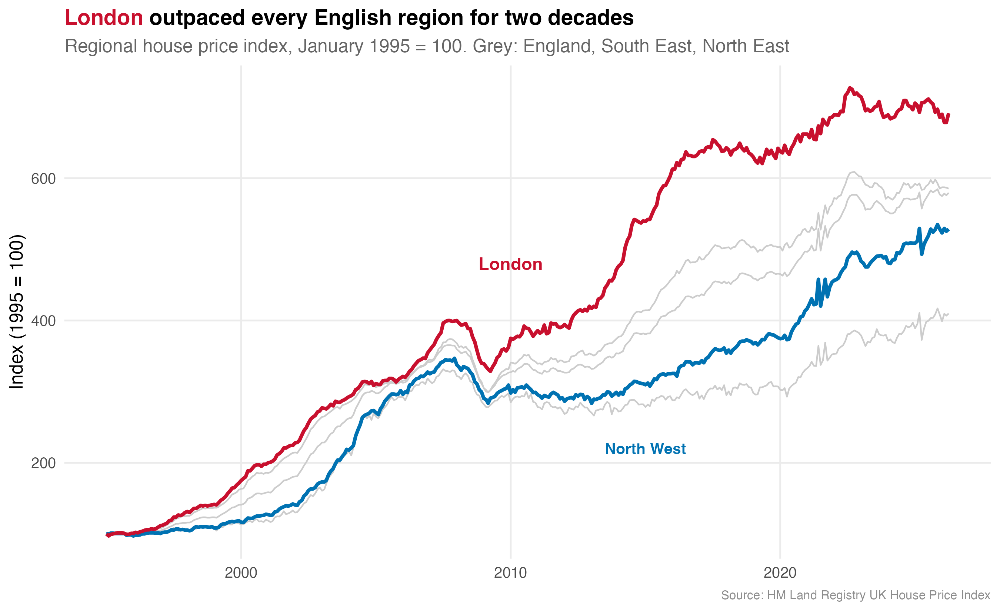
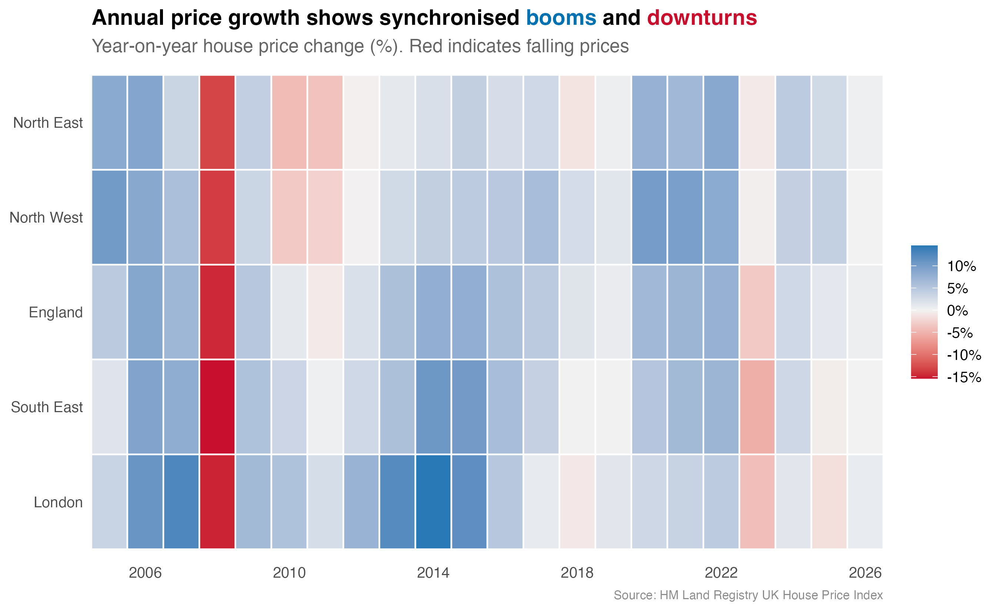

# Has London Housing Lost Its Crown?

A data story in six charts about regional house prices in England, 1995–2026. Built in R with ggplot2 on the HM Land Registry UK House Price Index.

> Individual coursework for **7BUIS009W Data Visualisation & Dashboarding**, MSc Data Science & Analytics, University of Westminster (July 2026).

<p align="center">
  
</p>

## Question

London is usually seen as the safe bet in UK property. Does the data still support that? This project compares London with the South East, the North West, the North East and the England average over thirty years.

## Data

[`data/hpi_clean.csv`](data/hpi_clean.csv) holds monthly data from January 1995 to April 2026 for 5 areas, 376 months each (1,880 rows). It is an extract of the **UK House Price Index** published by HM Land Registry, with these columns:

| Column | Meaning |
|---|---|
| `AveragePrice` | Average house price |
| `Index` | House price index |
| `SalesVolume` | Number of sales |
| `DetachedIndex` | Index for detached houses |
| `FlatIndex` | Index for flats |

The source is HM Land Registry, licensed under the [Open Government Licence v3.0](https://www.nationalarchives.gov.uk/doc/open-government-licence/version/3/). The full file can be downloaded from the [UK HPI data downloads page](https://www.gov.uk/government/statistical-data-sets/uk-house-price-index-data-downloads).

## The six charts

| # | Chart | What it shows |
|---|---|---|
| 1 | Regional index, January 1995 = 100 | London grows to about seven times its 1995 level and leads for two decades |
| 2 | 10-year growth, 2016–2026 (dumbbell) | London is **last, at 12%**, against 58% in the North West, 41% in the North East and 38% for England |
| 3 | London by property type | Flats led until about 2016; detached houses have done better since |
| 4 | London sales volume, 12-month moving average | Monthly sales never returned to their pre-2008 level |
| 5 | Year-on-year change heatmap | 2008 hit every region; the 2022–23 rate rises hit London and the South East while the North kept growing |
| 6 | £100,000 invested in 1995 | London is still highest at about **£691K**, ahead of the South East (£586K), England (£580K), the North West (£529K) and the North East (£410K) |

**Conclusion:** London's lead has shrunk but not disappeared. Owners there still hold the most housing wealth, but on growth alone London is no longer the obvious place to buy.

<p align="center">
  
</p>
<p align="center">
  
</p>

All six charts are in [`output/`](output/).

## How to run

Requires R 4.x with the following packages; the listed versions are the ones used for the check:

| Package | Version |
|---|---|
| tidyverse | 2.0.0 |
| scales | 1.4.0 |
| ggtext | 0.1.2 |
| patchwork | 1.3.2 |

```r
install.packages(c("tidyverse", "scales", "ggtext", "patchwork"))
```

Run the script from the repository root:

```bash
Rscript analysis.R    # writes output/viz1 ... viz6 (300 dpi PNG)
```

Run it under a UTF-8 locale (for example `LANG=en_GB.UTF-8`). Otherwise the £ sign in chart 6 cannot be drawn.

**Verification, 14 October 2026:** the script ran end to end in about 3 seconds and reproduced every figure quoted above, matching the submitted report. The PNGs in `output/` come from that run.

## Repository structure

```
analysis.R           builds the six charts from data/hpi_clean.csv
data/hpi_clean.csv   UK HPI extract: 5 areas, 1995-01 to 2026-04
output/              the six charts
```

The only change to the submitted script (`analysis_final.R`) is the data path, which now reads `data/hpi_clean.csv`.
